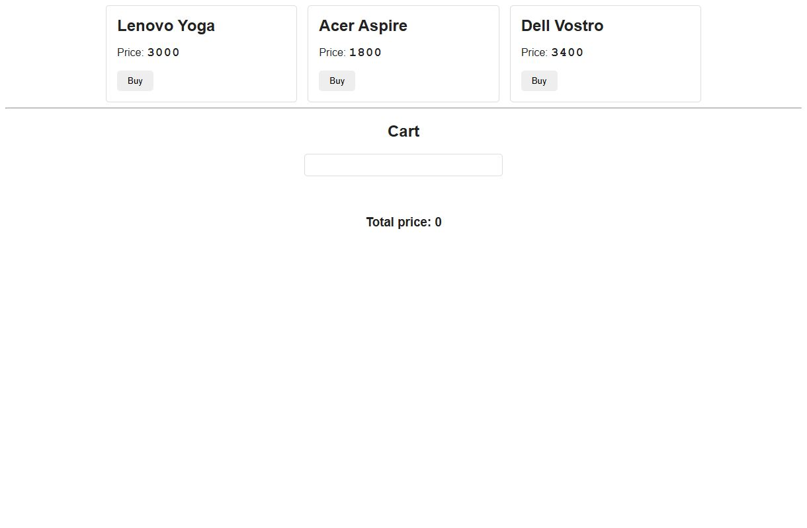

# 🛒 Витрина ноутбуков

**Компактная корзина, в которой видна связь между выбором товара и суммой покупки.**

  

[Открыть витрину](https://goldlexx.github.io/showcase/)

Нажмите **Buy** возле ноутбука, чтобы добавить его в корзину. Второй клик не дублирует позицию. Нажатие на товар в корзине удаляет его и пересчитывает итог. Логика выбора и подсчёта находится в [js/script.js](js/script.js).

## Локальный запуск

Откройте `index.html` из корня репозитория в браузере.

## Проверка

`node --test js/script.test.js` проверяет добавление, защиту от дублей, удаление и итоговую сумму.
